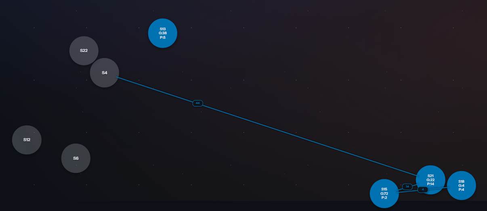
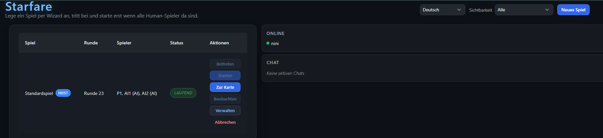
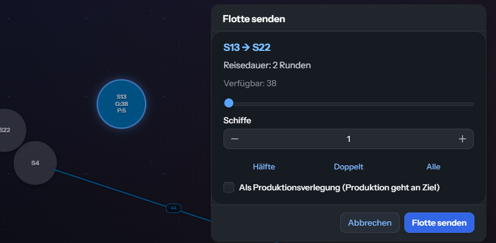
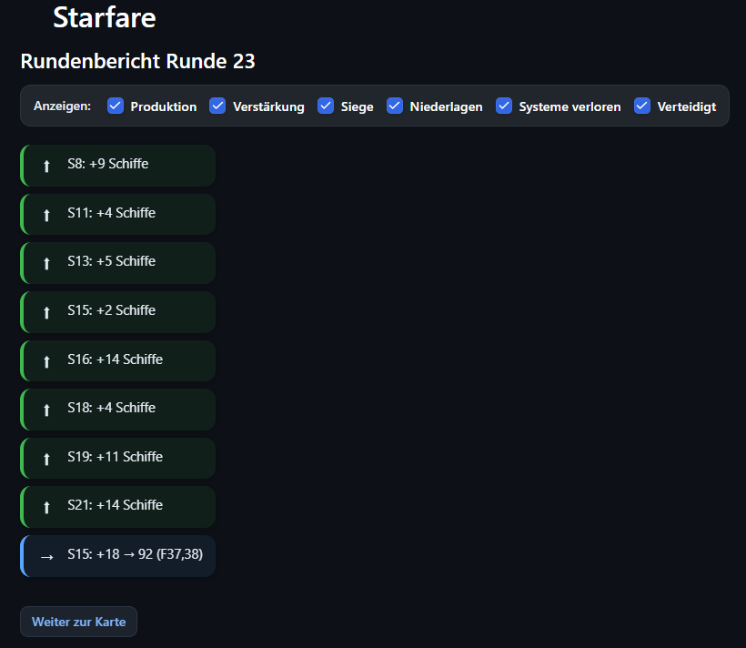

# Starfare

[](https://github.com/MichaelZett/starfare/actions/workflows/build.yml?query=branch%3Amain)
[](https://sonarcloud.io/project/overview?id=MichaelZett_starfare)
[](https://sonarcloud.io/component_measures?id=MichaelZett_starfare&metric=coverage)

A multiplayer space strategy game in the browser. Humans and AI empires share a
galaxy, conquer star systems and dispatch fleets; a round is resolved once every
human has submitted.

**Play now: [games.zettsystems.de/starfare](https://games.zettsystems.de/starfare)** —
create an account on the platform and start a game against the AI or invite
friends. **Spielanleitung auf Deutsch:** [Anleitung](docs/ANLEITUNG.md).

## The goal: SectorForces, classic and extended rules

Starfare rebuilds *Sector Forces*, a Commodore 64 strategy game that can no longer
be found, most likely a German clone of *Galactic Empire* (1983). Lobby, AI
opponents, archive and the map are shared; each rule set brings its own rules.
Every game stores its variant and rule version.

| Variant | Status |
|---|---|
| **Classic** (`classic`) | Playable, rules 1.0.0 |
| **Extended** (`spaceward`) | Playable, rules 2.0.0 (Classic plus industrial expansion, flight range with stations, alliances and coalition combat); alpha stage inside the platform host |

The classic rules are the compact core of conquest and fleet movement. The
extended rules add industrial expansion, limited flight range, alliances and
coalition combat. In code, commands and stored rule versions the extended rules carry
the technical key `spaceward` (`spaceward/2.0.0`).

Starfare is an independent hobby project. It is not affiliated with or endorsed
by the publishers or rights holders of *Sector Forces* or *Galactic Empire*; their
names only describe the inspiration. No original code or assets are used.

## Feedback and issues

Bugs, ideas and questions are welcome as
[GitHub issues](https://github.com/MichaelZett/starfare/issues), in German or English.

1. Sign in to GitHub (a free account is sufficient).
2. Check the [open issues](https://github.com/MichaelZett/starfare/issues) for
   the same topic; if you find it, add a comment or a 👍 instead of a new issue.
3. Open [New issue](https://github.com/MichaelZett/starfare/issues/new/choose) and
   choose **Bug report** or **Idea**. The form asks for everything needed:
   - for bugs: what you did, what you expected and what happened instead;
   - the game variant and rule version (shown in the lobby and on the rules card of the new-game dialog);
   - the round, your browser and, if possible, a screenshot.
4. Submit. You will be notified about replies on GitHub.

Issues are public. Do not post passwords, email addresses or other personal data.
Report security vulnerabilities privately as described in [SECURITY.md](SECURITY.md).
Without a GitHub account, use the contact address in the game's imprint.

## About this repository

Built as a Spring Boot / Vaadin web application. This repository is also a
personal showcase of a modern Java backend stack (Java 25, Spring Boot 4,
Vaadin 25, Spring Modulith, Flyway, Testcontainers) wrapped around a small but
complete game.

## Game variants and rule versions

Choose the rules first in the new-game dialog: **Classic** (rules **1.0.0**) is preselected,
**Extended** uses rules **2.0.0**; each variant has exactly one version and the dialog
shows no version number. Inside the games platform host each variant has a stage the
platform keeps (alpha, beta, production; Extended starts in alpha): the platform decides
who may use it, the rules card marks alpha and beta variants, and an account that may no
longer use a variant loses access to its games, running ones included. In Starfare's own
start every variant is open.

Every game stores its variant and rule version independently of the application
release. Existing games without a variant are Classic games. Games of the retired
extended versions 1.x no longer load; lobby, finished games and the platform's open
decisions leave them out without failing. Lobby, joining, management and archive show
the selected rules. Templates and rematches retain them.

### Extended rules

Extended is Classic plus four things; events, start balance by position and the round
limit stay Classic-only.

- **Industrial expansion.** Every system has a capacity, starting at its production and
  capped at 50. The system details show one **Expansion** control (number field with
  step buttons and a slider from 0 to the capacity); the rest of the capacity builds
  ships. A result line reads e.g. "6 ships/round · Expansion 4/10 · done in 3 rounds".
  Numbers and step buttons save at once, the slider when released; dragging only
  previews. The next level costs `min(2*C, max(2, ceil(C*C/10)))` points at capacity C
  (C=2 costs 2, C=5 costs 3, C=10 costs 10, from C=20 twice the capacity); several levels
  may complete in one round, progress carries over, and new capacity is usable next
  round. Capture keeps capacity and progress and resets the allocation to full
  shipbuilding. Lowering a system's shipbuilding below its outgoing relocations shortens
  them proportionally and names each change.
- **Flight range with stations.** Each game has a fixed range per leg, the longest edge
  of the galaxy's minimum spanning tree. During target selection a dashed circle shows
  the direct range; targets and the send dialog read **Directly reachable**, **Via N
  stations** or **No route**. Routes run through owned or allied systems with one full
  refuelling round per stop; the rules for stops are in the map help.
- **Alliances.** Unanimous alliance groups with a fixed notice period of three rounds;
  after a departure, stationed and inbound partner fleets return home without fighting.
  Computers accept requests unless they announced their own departure and never found
  alliances themselves.
- **Coalition combat.** All hostile sides fight simultaneously, including stationed
  support. Ships retain their empire; a conquest beneficiary can be chosen before launch.

Victory: an individual empire needs 70% of all systems. Otherwise an alliance of at least
two members wins with 70% together; the group with the most systems wins (group ID breaks
ties), and every member wins, including members without systems. Neutral systems remain
in the denominator. Any winning member may continue once, raising both thresholds to
100%; the first result remains. The game end shows **Industry built** with the capacity
points the player expanded.

## Computer strength

The new-game dialog offers one computer strength for all computer seats
(named constants in `ComputerStrength`; Classic values calibrated with the strategy benchmark):

| Strength | Play | Computer start |
| --- | --- | --- |
| Easy | Baseline | ×0.5 (production 2, 4 ships) |
| Normal (default) | Classic: Cautious; Extended: Baseline | as humans |
| Challenging | Classic: Baseline, in duels secretly Baseline or Rush; Extended: Adaptive industry | Classic ×1.5 (production 6, 12 ships); Extended as humans |

Cautious keeps three rounds of production at home against one rival (fewer with more
rivals), sends at most one fleet per round and only when a system's spare ships beat the
estimated defence at arrival by half again; it then sends all of them, preferring near,
weak and neutral targets. Rush commits ships early; Expansion favors nearby neutral systems; Concentration
moves spare forces toward the front; Defense keeps larger local reserves; Adaptive
industry adjusts investment to visible threats and available ships. The profiles use
the same policies as the strategy benchmark and consume only player-visible
information and legal route durations. The strength is saved with the game and kept
by templates and rematches; the drawn profiles are stored per seat.

## Lobby and archive

Games with more than one person are public unless **Invitation only** is ticked; a game
against the computer alone is always private and has no such option. Use **Manage** to invite
players or change the visibility before the game starts. Public games can be found by other signed-in players; private
games are visible to the host, seat holders and invitees. Visibility is fixed
once the game starts.

Inside a platform host the platform lists finished games with a link to the review; in
the own start they move from the lobby to **Archive**. Search by game or player name,
filter your games and open a completed map without issuing further orders.
**View** opens the review. Returning to
the archive within the same account session restores filters and scrolls to the
last viewed game.
When the final round contains located events, the round report walks through them first.
Resolve every battle from that report, individually or together in **Instant** mode, and
confirm the other events; only then does the victory or defeat dialog appear,
with personal totals for built, destroyed and lost ships. Extended games also show
**Industry built** in capacity points, summed from per-round summaries captured at the
production step.
In the completed map, select any participant (including AI) and enable **Fog of war**
to see their final perspective. Disable fog to reveal all systems and fleets.
For newly completed games, the timeline can rewind to every resolved round;
**Final state** returns to the perspective and fog controls.
Private archives remain restricted to the host and seat holders. For public
archives, outsiders can open the map only when spectators are allowed. Games
are copied to an independent archive. A finished game stays reviewable for 90 days
after its end; then a daily cleanup deletes the game and its archive entry together
(`starfare.game.archive-cleanup.enabled`, default `true`; `.retention`, default `P90D`).
Who played whom and the result stay in the platform's statistics.

## Map sidebar

Map controls provide zoom, whole-galaxy and own-empire views. **Map help** contains
reset and the legend (in Extended also the rules for stops at stations); on phones the
question-mark button opens it. The sidebar has four tabs, Details, Fleets, Relocations
and Report, also when it is narrow and on phones. Above them sit **Alliances** (Extended
only) and **Undo last order change** as icon buttons. The **game chat** belongs to the platform: its button sits in the
platform's strip above the map and in the waiting room, on phones as well. Starfare only says
who may read and write: everyone who holds or held a seat reads the chat; only those still
playing write. Whoever left, resigned or lost the seat to the computer, and everyone after the
game ended, only reads. Observers have no chat. The own start has no game chat.
Focusable map objects and action cards accept Enter and Space. Background updates
preserve unchanged input controls and focus. In the own start, **My account** leads to
lobby and archive; imprint and privacy share a footer.

System details put sendable ships, total garrison and forecast ship
production per round above the send and relocation actions, followed by the
system's incoming and outgoing relocations; in Extended games the industry follows.
**Logistics** expands the relocation balance (incoming, production, outgoing) and
arrivals. **Background** expands the ownership history of fully visible systems.
Expanded sections stay open across updates and system selections while their data
follows the selected system.

Cancelling a send with Cancel, Escape or an outside click retains the source and
target selection. Success confirms the queued order and keeps the source details
open for the next send. Relocation edits retain their current context.

Fleet cards and fleet details offer **Wait** directly and **Disband** when the
fleet can return to an owned garrison. Action clicks retain the current tab.
**Travel details** and **Joint arrivals** expand the additional journey data.
The Fleets tab lists fleets under way and the orders queued this round in one list,
grouped by arrival round (fleets first within a round); **Joint arrivals** aggregates
them by destination and arrival turn, including waits. Use **Edit order** to change a queued send's destination or
amount. **Undo last order change** reverses your most recent queue change in the
same round, including after a reload or server restart. It cannot undo a resolved
turn.

Select a foreign system or one of your flying fleets on the map, and each of your
systems with ships to spare shows the round a fleet sent from there now would arrive
(along the same routes the game uses, so extended range and stopovers count). Click
those badges to pick the sources of a **joint attack**; the button above the target
shows the common arrival (the latest among the picked sources) and opens a short
confirmation with the ships per source (all available by default). The slowest
sources leave now; faster ones get a planned later start so that all arrive in the
same round. Until then their ships stay in the garrison and defend it, but are
reserved and cannot be sent twice. Planned starts are listed in the Fleets tab and can
be cancelled while the round is open. A start whose source is lost, whose ships are
gone or whose target can no longer be reached is cancelled with a report line; with
fewer ships left, the rest starts. A target that became your own or an ally's is
still flown to.

With battle speed **Instant**, **Resolve all open battles** acknowledges the complete
round. Speed, sound, report filters, route search and sidebar width are
saved per account and restored on later sign-ins.

Use **Use as template / rematch** on your lobby games or in the review of a
finished game (the bar above the map) to reuse the
original settings with a new map. Rematches reserve the previous human seats;
players still join themselves. Games created before original settings were saved
cannot be used as templates. New games remain private until explicitly published.

The right-hand sidebar keeps the map visible and switches between Details, Fleets,
Relocations and Report. Select a system or fleet on the map to inspect it in Details:
foreign systems out of sight show the last reconnaissance (owner, estimated or counted
garrison, production, round of last contact), own systems their known ownership history,
fleets their owner, launch turn, travel time and ETA. The report entry contains
the complete filterable round timeline, including victory and defeat reports.
Single sends and relocations retain the current tab; a joint attack and editing an
order open Fleets.
Resolving a new round walks through its located events one by one
(battles, conquests, losses, cosmic news with a system, cancelled or reduced starts of a
joint attack). The report lies as a curtain in front of the whole board: map, sidebar and
header are darkened and take no input, only the event's system stays bright, and the card
in front ("Round 12 resolved", "Event 1 of 3") offers the playback of a battle or
**Continue** for every other event. The map centres on each event. Once the last one is
confirmed the curtain lifts and orders and **Submit turn** are open; the progress is stored
per account.
Spectators and the review are never held up.
Systems mentioned in a report carry a gold marker on the map. Select a report
entry to centre the map on it, or select the marker to return to its report
entry.
Production relocations appear as purple dashed connections with their amount.
Drag one of your systems onto another system to create or replace a relocation;
the dialog limits the amount to the available routing capacity.
System details and the send dialog show incoming transfers immediately after
production, for example `4 (+6/turn)`. Source and destination details offer
**Cancel transfer** directly; already travelling fleets remain unchanged.
Gameplay and the map header use empire names; overviews and diplomacy also show
account names in parentheses.
All game commands remain available only in a running game.

## Tech stack

- **Java 25** with virtual threads.
- **Spring Boot 4** — web, validation, security, data-jpa, flyway,
  actuator.
- **Vaadin 25 (Flow)** — server-driven UI, language switcher, fog of
  war on an SVG map.
- **Spring Modulith** — module boundaries verified on every test run.
- **PostgreSQL 18** via Flyway migrations and Testcontainers in tests.
- **Gradle (Groovy DSL)** with quality gates: ErrorProne + NullAway,
  SpotBugs, JaCoCo, SonarQube, OpenRewrite.

Architecture details: [docs/ARCHITECTURE.md](docs/ARCHITECTURE.md).

## Screenshots

These images show earlier interface versions. Current controls and behavior are
described in the sections below and in the [German guide](docs/ANLEITUNG.md).



*Galaxy map: own systems in blue, neutrals grey, a fleet in transit with
an ETA badge mid-route; systems within sensor range show a rough garrison
estimate, everything beyond stays frozen at its last known state.*



*Lobby: running games with host actions, search and status filter,
presence panel, chat, language switcher and a per-user visibility menu.*



*Send-fleet dialog: ship slider with quick buttons (half / all /
all except production), travel-time preview, optional "as production transfer"
mode.*

Starfare keeps no statistics of its own: at the first end of a game it announces
the places to the platform (`MatchEnded`, games-platform-api), whose statistics
cover all games. `game_results` only remembers that a game has ended.
For newly completed games, the archive map also provides a timeline for replaying
each resolved round.



*Round report: a filterable timeline of production, reinforcements,
victories, defeats, and systems lost or defended.*

## Run it

Prerequisites: Java 25, Docker Desktop (for PostgreSQL).

```bash
./gradlew bootRun
```

On first start, `spring-boot-docker-compose` brings the Postgres
instance up automatically and supplies its connection details. The local database
port is bound to loopback. Without Docker Compose, set `SPRING_DATASOURCE_URL`,
`SPRING_DATASOURCE_USERNAME` and `SPRING_DATASOURCE_PASSWORD` explicitly; the
application has no fallback credentials. Then open
[http://localhost:8110](http://localhost:8110); you play as the standard account,
without signing in.

For local development with Vaadin hot reload:

```bash
./gradlew bootRun -Pvaadin.productionMode=false --args=--vaadin.productionMode=false
```

The SonarCloud analysis includes application sources, authored frontend files and
both test source sets. Generated frontend files are excluded. CI uses the
repository secret `SONAR_TOKEN` for SonarCloud. For the shared local SonarQube
instance, use its local token and select the target explicitly (global Gradle
properties may otherwise select the cloud organization):

```powershell
$env:SONAR_TOKEN = "<SonarQube-Token>"
.\gradlew.bat test jacocoTestReport sonar "-Dsonar.host.url=http://localhost:9000" "-Dsonar.projectKey=starfare" "-Dsonar.token=$env:SONAR_TOKEN"
```

## Accounts

Starfare's own start has no sign-in: whoever starts it plays as its standard
account (Commander) against the computer. Accounts, friends, invitations to other
players and statistics belong to the platform host games-platform, which asks
nobody to sign in to Starfare separately. Starfare stores the account ID as the
player reference; the public player name comes from the platform.

## Language

Top-right in the lobby and the map view there is a language switcher
(German / English). The choice is kept in the Vaadin session and
survives navigation and reload; the default is German.

## Lobby

The landing route `/` is the lobby. From there:

- **New game** — opens the one-page dialog **New game** (picture cards and drop-downs, no
  summary page; **Create game** creates it):
    - Game: a random name (roll again with the die), rules Classic or Extended, empire name
    - Players 2–10 (default 3), of which computers 0..n−1 (default all others), computer
      strength Easy / Normal / Challenging (default Normal), tempo only with more than one human,
      invitation only (default off; only with more than one human, games against the computer
      alone are always private), tutorial
    - Map: layout even or random; galaxy size Small 16 / Medium 24 / Large 30 / Huge 40
      systems (default Medium; sizes with fewer than two systems per player are locked);
      highest neutral production 6 / 10 / 15 / 20 (default 10)
    - Chance: None / Low / Medium / High (default Low), see below
    - Details (Classic only, collapsible): single galactic events (unless chance is None)
      and a round limit (off or 10–500)
    - If every other seat is a computer, the game starts at once.

  Fixed for every new game: home system with production 4 and 8 ships, start balance by
  position, colours from the palette in seat order, victory at 70% of all systems,
  observers and rejoining allowed, battle presentation on (each account's saved speed
  choice overrides it). Neutral systems produce 1 up to the chosen maximum, bell-shaped
  around the middle. Extended games allow alliances, alliance victories (70%) and
  computer alliances.

  | Chance | Combat strength | Events (Classic) | Several attackers |
  | --- | --- | --- | --- |
  | None | exact | off | strongest first |
  | Low | ±5% | rare | random order |
  | Medium | ±10% | normal | random order |
  | High | ±20% | frequent | random order |

  Extended games resolve all hostile sides together, so chance only affects combat
  strength there.

  Fleets fly at one fixed speed on every map: 160 map pixels per round, at least 2 and
  at most 40 rounds. Density is fixed at 240,000 square pixels per system, so larger
  galaxies are wider (Small 2600×1670, Medium 3160×2020, Large 3510×2240, Huge
  4040×2570). Neighbours are usually about three rounds apart; crossing the whole map
  takes about 19 / 23 / 25 / 29 rounds. Each game stores its map size in the snapshot.
- **Search / filter** — narrow the list by game or player name, and by
  status: all, mine, open or running games. Finished games are in **Archive**.
- **Join** — take an open slot. One slot per game; first come, first
  served.
- **Observe** — read-only spectator mode (when allowed by the game).
- **Start** — available once all human seats are filled. The initiator
  starts the game.
- **Open map** — for running games you are playing or observing.
- **Abort** — close the game entirely (only meaningful while nobody is
  actively playing).

## Privacy

Accounts and their deletion belong to the platform host; a deleted account reaches
Starfare as `AccountRemoved`, and Starfare removes what belongs to it. The platform keeps the
game chat and took over the messages of Starfare's former own chat; Starfare's old chat table is
gone since 0.2.15. The own start still serves `/privacy` and
`/imprint` from its former public operation until plan M19 removes them.

## Map view (`/starfare/map/:gameId`)

Top: **Starfare**, game name, round number and an empire summary with
icons for owned systems, total production per round and total ships
(garrisons plus those en route).

Centre: the galaxy map. Owned systems are in the player's colour,
enemies in the opponent's colour, neutrals grey. Visibility comes in
three levels:

- **Own systems** — exact garrison and production.
- **Within sensor range** — up to two travel rounds from one of your
  systems or a fleet's destination. Owner and colour are live, the
  garrison is only a rough estimate (shown as `~G:`).
- **Everything else** — whatever you last learned in combat there
  (`G:`, with the round it was seen in the tooltip), or nothing at all.

System diameters provide an extra map cue without leaking hidden information:
your systems follow their production, sensor estimates follow estimated
production, and systems without current intelligence all have the same size.

Travelling fleets are rendered as SVG lines with arrowheads; halfway
along sits a small pill with the ship count, whose tooltip shows the
arrival round and remaining turns.

- **Pan**: hold left mouse button and drag.
- **Inspect system**: left-click to open its details.
- **Prepare a fleet**: right-click your source system to start target selection
  directly, then left-click the target. You can also use **Send fleet** in the
  system inspector.
- The initial view centres on your home system.

### On a phone

Phones get their own interface; tablets, laptops and desktops keep the regular
one. The server decides once per session from the browser and builds only that
interface. `?layout=mobile` or `?layout=desktop` on any page overrides the choice
for the rest of the session.

On the map, the phone layout shows a compact header (game, round, empire summary,
**End round** and the menu), the map across the
whole screen and a bottom bar switching between **Map** and **Overview**. The
overview is the sidebar as a full-screen sheet with the same four tabs, together with
alliances and undo. Swipe to pan; zoom with two fingers or the round buttons, which also fit
the view to your empire or the whole galaxy; the question mark opens the map help
with the legend. Tapping a system opens its details;
**Send fleet** returns to the map with a banner until you tap the target or cancel.
Dialogs fill the screen with their buttons fixed at the bottom.

### Send a fleet

1. Right-click your source system, or select it and choose **Send fleet**.
2. Click the target system.
3. Set the ship count via slider or input field. Quick buttons:
   **Half**, **All** (available ships after queued sends),
   and **All except production**, which retains the nonnegative net flow of production + incoming − outgoing transfers. Incoming ships still travel normally.
4. **Send fleet**.

The order lands in **Fleets** in the right-hand sidebar. Before submitting your
turn, use **Edit order** to change its amount or target, or **Cancel** to remove it.
**Undo last order change** restores your queue before the most recent command
change, including a whole joint attack. It is a single undo step, not an undo history.

Ticking **as production transfer** turns the order into a standing one: the
given number of ships is shipped every turn. A system may route at most its
own production plus whatever is routed into it, and several targets share that
budget — the map shows the still-free share in brackets after `P:`. Whatever
is not routed stays behind as garrison. The **Relocations** tab also offers
**Edit** and **Cancel transfer** on every route and directly at either system; editing opens the same capacity-aware
dialog.

### Own fleets

The **Fleets** tab shows route cards for ships already in transit and a combined
arrival preview with queued sends. Select a card to see fleet details. Route
search filters the cards; the summary groups arrivals by destination and round.

The send dialog, fleet cards and details share a graphical itinerary. Known
system points focus the map without sending orders or changing the quantity.
Long routes expand inline; the current and next stations remain visible when
collapsed. Blocked journeys show an open arrival rather than an old promise.
The send dialog lists exact leg durations and refuelling stays in its details.

The Extended **Alliances** dialog puts pending decisions before your alliance
and possible partners. Leaving requires confirmation showing the effective round and
consequences for stationed fleets; treaty rules remain in an expandable section.

- **Wait** — the fleet rests one round at its current position
  (ETA +1).
- **Disband** — the ships are abandoned. Only allowed in certain
  states.

### End the round

In the header and its menu:

- **Submit turn** — submits your turn. The button then reads **Submitted**
  and is disabled; the round bar names the players still to submit. This notice
  survives reload and disappears when the next round starts. Once all humans have submitted,
  the turn pipeline runs (AI orders → due joint-attack starts and all orders →
  production → wait orders → arrivals/combat → events → victory check → next round).
  A bar below the header shows every human with a check mark once they
  have submitted. With two or more humans each round has a deadline: the
  round limit from the start of the round, and the straggler limit as soon as
  only one player is missing — their chip then shows the countdown. The tempo
  chosen in the new-game dialog sets both and stays fixed for the whole game: Live
  (5 min / 1 min), Brisk (1 h / 15 min), Daily (1 day / 6 h) or Relaxed
  (3 days / 12 h). A click on submit that arrives after the deadline ended the
  round is refused instead of submitting the next round. Whoever misses the deadline
  moves with the orders given so far. Missed rounds count over the whole game:
  the second one times the seat out, the AI takes it over for good and there is
  no way back, even if the game allows rejoining. The former player still reads
  the chat. The result reports them as removed for missed turns, on the place
  they held at the removal; a win of the AI with their empire is not theirs.
  Games created before tempos keep their deadlines, which the host can still
  adjust through **Round deadlines** in the map menu. A game with only one human
  has no tempo and no automatic round deadline.
- **Leave game** — your seat becomes AI. If rejoining is allowed, you
  can come back later.
- **Back to lobby** — exit the map view; the game keeps running.

After every turn change the app shows a **round report** with the
events (production, combat, conquests). A battle card first only names its
location. Click it for a separate battle playback: both fleet strengths count
down over a sun-and-planet background, with scaled ship markers and optional
sound. The browser activates audio on the first click on a battle card. Use
the report's **Speed** selector to choose **0.5×, 1×, 1.5×, 2×, Instant**.
**Instant** skips animation and also offers **Resolve all open battles**, including
battles hidden by report filters. Speed and sound are saved per account for later
rounds and sign-ins; the game default applies until you make a personal choice.
The playback dialog also lets you change animation speed and switch sound (switching it
on plays a short impact), and names the system's production as far as you know it;
there is no separate conquest dialog afterwards.
The result appears only after acknowledging the battle;
until then the map shows a large battle marker and conceals the affected
system's owner and values. Continue via **Back to map**.
Battle acknowledgements are saved per account, game, round and event; reloading
or signing in on another device does not reset them. Display speed does not
change combat outcomes or round deadlines.
Both fleets begin in neutral yellow and turn green or red only with the final
result; attackers stand left, defenders right. Crew-condition text describes the rolled
combat variation, and **Combat details** shows the exact strengths. A pending map marker
keeps neutral systems grey and known player-system colours faded, without revealing
combat details.

## Victory condition

New games require 70% of all systems. Neutral systems count towards the total; older
games keep their stored threshold. Once a player reaches the required share, the game ends; after pending battles are acknowledged, the result dialog
shows the winner and personal ship totals.

The winner can choose **Continue until every system is conquered** to resume toward 100%.
This restarts the round deadlines and clears submissions without advancing the
round. Other participants are informed automatically. The first end is the one
reported to the platform; continued play does not end the game a second time.
A Classic game that ended by its round limit cannot be continued. Extended games also
know an alliance victory (section "Extended rules").

**Resign** sits next to **Leave** in the map menu. The computer takes over the empire until
the end of the game; unlike leaving there is no way back, even when the game allows re-entry.

## SectorForces: galactic events and scoring

Inspired by the C64 classic Galactic Empire (1983). How often events occur follows the game's
chance level (None: never, Low: rare, Medium: normal, High: frequent); older games read as off and
keep rules 1.0.0.

- **Random events**, each can be switched off on its own under **Details**: cosmic
  storms (every fleet in hyperspace one round later), space-time quake (half the remaining
  travel time), mysterious disappearance of ships, spaceport quake and supernova.
- **Supernova:** the report warns everyone ("unstable sun") and the map marks the system for
  one round. Then it is destroyed for good, no longer counts towards the victory threshold and
  can no longer be targeted. Its garrison flees to a random system; fleets bound for it jump on.
  Home systems never explode.
- **Pirates** (needs the supernova): the garrison of a neutral sun flees as a pirate fleet
  without a seat. A successful raid leaves the system neutral.
- **Start balance by position** (always on): homes close to opponents get more ships, homes with
  many neutral systems nearby fewer (between half and twice the regular garrison).
- **Round limit** (10–500): if nobody reaches the threshold, the best score after the last round
  wins (400 per system, 25 per stationed ship, 20 per ship in flight; ties go to more systems,
  then the lower seat). The last five rounds are announced.

## Observer mode

Non-participating users can follow the map live (new games always allow observers;
older games keep their setting). They select a participant perspective and can
switch the fog of war on or off; spectator views never permit commands. In
pure-AI games the round runs automatically (autoplay) until the last observer leaves or the game
ends.

## Release

`appVersion` in `gradle.properties` drives releases. While a version ends in
`-SNAPSHOT`, pushes to `main` only build and test. To release:

1. Remove the `-SNAPSHOT` suffix.
2. Rename `## Unreleased` in `CHANGELOG.md` to `## <appVersion> - <date>`.
3. Commit and push to `main`. The workflow tags `v<appVersion>` and creates a
   GitHub Release with the changelog section and `starfare.jar`. Afterwards it
   bumps `appVersion` to the next patch `-SNAPSHOT` (`[skip ci]`) — run `git pull`
   before continuing.

There is no image and no deployment of its own: in production Starfare runs as a
game module inside the platform host games-platform. A release goes to production
only when its commit message contains `[deliver]`, e.g. `Release 0.2.8 [deliver]`:
then the job `deliver` starts `game-update.yml` in the host. Without the marker the
release stays a tag and GitHub Release, and a later host release takes the version
along (`starfareVersion` in the host's `gradle.properties`, host README, section on
platform releases with several games).

### Running it on a server

The own start is meant for local play; on a server Starfare runs inside the
platform host. Without a sign-in everybody reaching the own start plays the same
standard account, so do not expose it publicly.

`/actuator/health` answers `UP` (200) or `DOWN` (503); the public answer carries the
status only. Other actuator endpoints stay closed.

Slow page builds and UI actions (`starfare.timing.slow-page-ms`, default 500 ms),
and slow round resolutions (`starfare.timing.slow-round-ms`, default 1000 ms) are
logged at WARN; `0` disables a threshold.

## Tests

`./gradlew test` runs the unit and integration tests (PostgreSQL via
Testcontainers), including Vaadin Browserless checks of real views with test
accounts as a platform host has them (`testsupport.TestPlatformAccounts`). These cover map dispatch and round broadcasts, switching
accounts in the private lobby, and automatic navigation after creating a game.
Industry journeys cover creating Extended games through the new-game dialog, saved
expansion shares, locking after submission and relocation trimming.
Map journeys cover fleet actions, joint attacks with later starts, editing and undo,
saved filters after a new sign-in, rematches, relocation limits, station routes
and coalition ownership, concealed results, persistent battle acknowledgements and
the round start walkthrough (also after reloading and on phones).
Game-end journeys cover alliance proposals, notice periods and departures with two
accounts, continuing a won game towards full conquest, and victory staying hidden
until the last battle has been evaluated, also after reloading.
They need neither Chrome nor a running HTTP server. `./gradlew e2eTest` runs the
Cucumber/Selenium journeys that need a real browser against the real application in
headless Chrome: sign-in of a test account and one round, round submission pushed between
two sessions, battle playback with audio, native relocation dragging, hit areas, keyboard
use and separate map viewports, route and range geometry, and layout screenshots at
desktop widths. An emulated iPhone checks the phone interface by real taps next to a
desktop session. It is not
part of `build`. CI runs it as a separate job
(`[skip e2e]` in the commit message skips it). Failures leave page text in the
test output and a screenshot in `build/e2e-failures/`.

The `@ui-acceptance` journeys cover choosing picture cards in the new-game dialog, lobby invitations and
archive access, two-player deadlines, final battles and coalition dispatch.
They save current screenshots and visible text in `build/ui-acceptance/` for
personal review. Automated checks do not replace a player's usability assessment.
The `@layout` journey preserves layout checks while functional journeys move to
Browserless: lobby, new-game dialog, system details, archive and review at
1366 and 1024 pixels. The `@economy-layout` scenario checks the industry with its
expansion slider at both widths. Navigation checks retain the range circle, route preview and refuelling card layout;
coalition checks retain neutral start colors, side placement and animated end counts.
Their screenshots use the `navigation-*` and `coalition-*` prefixes in `build/ui-acceptance/`.
Screenshots and text are saved as `build/ui-acceptance/layout-*`.
Both this journey and the smoke test reject severe browser-console errors and
visible Vaadin system errors.

```bash
./gradlew test
./gradlew e2eTest
./gradlew e2eTest "-Dcucumber.filter.tags=@ui-acceptance"
./gradlew e2eTest "-Dcucumber.filter.tags=@mobile"
./gradlew e2eTest "-Dcucumber.filter.tags=@layout"
node --test "src/test/frontend/*.test.mjs"
```

Integration tests start a single PostgreSQL container via
Testcontainers; Docker must be running.

## Strategy experiments

The first verified pilot results and their limitations are documented in
[the experiment report (German)](docs/STRATEGY-EXPERIMENTS.md).

The opt-in `strategyBenchmark` task runs Classic and Extended games through the real
turn engines without Spring, PostgreSQL, a browser or audio. Running the tooling does
not alter stored games or their AI selections. Modes are `matrix` (default),
`multiplayer`, `decision`, `alliance` and `strength`; `--rules=classic` selects Classic
1.0.0, `--rules=spaceward` Extended 2.0.0.

```powershell
# Pairwise matches, with both seat assignments for every pair.
.\gradlew.bat strategyBenchmark "-PstrategyArgs=--seeds=3 --systems=16,32 --rounds=120"
# Rotate every strategy through every seat of a multiplayer game.
.\gradlew.bat strategyBenchmark "-PstrategyArgs=--mode=multiplayer --seeds=3"
# Compare one changed decision against the same checkpoint and future round seeds.
.\gradlew.bat strategyBenchmark "-PstrategyArgs=--mode=decision --seeds=3 --combat-seeds=3 --fork-round=10"
# Four empires, with a fixed alliance between seats 1 and 2.
.\gradlew.bat strategyBenchmark "-PstrategyArgs=--mode=alliance --rules=spaceward --seeds=3"
# Pair identical Extended scenarios with group victory disabled/enabled.
.\gradlew.bat strategyBenchmark "-PstrategyArgs=--mode=alliance --rules=spaceward --alliance-victory=both --seeds=3 --combat-seeds=3"
```

Use `./gradlew` on Linux/macOS. Results default to `build/strategy-harness/<mode>/`;
`--output=build/strategy-harness/my-run` selects another directory. Reusing an output
directory replaces its report files. Options use `--key=value`; quote the entire
Gradle property as shown. Paths supplied through this property must not contain spaces.
Without `--rules` the matrix, multiplayer and decision modes run both variants;
`--rules=classic` or `--rules=spaceward` narrows them. `--layouts=RANDOM,EVEN`
selects galaxy layouts. Defaults are two map seeds, 16 systems, 120 rounds and 10%
combat variation. `--first-seed=1001` selects a disjoint validation map set after
tuning on the initial seeds. `--combat-seed=314159` and `--combat-seeds=3` control
independent combat repetitions per map. `--randomness=0` isolates deterministic
combat; random attack ordering still uses its own seeded stream.

Strategies are intentionally small, contrasting policies:

| Profile | Behavior |
|---|---|
| BASELINE | Existing variant AI, invoked unchanged on an isolated copy for each seat. |
| RUSH | Early, large attacks with a minimal reserve, including risky engagements. |
| EXPANSION | Prefer accessible, weak or apparently neutral systems; retain a production-sized reserve. |
| CONCENTRATION | Attack estimated beatable targets and transfer idle forces towards the front. |
| DEFENSE | Keep a larger reserve and strongly prefer lower-risk targets. |
| CAUTIOUS | Classic normal computers: home guard, at most one fleet per round, only with a clear superiority at arrival, then all spare ships; near, weak and neutral targets first. |
| INDUSTRY | Extended only: invest two thirds of capacity away from known nearby enemies, one fifth near them; consolidate idle forces. |
| INDUSTRY_LIGHT | Extended only, explicit selection: invest one quarter of capacity when visible enemies are more than two travel rounds away; use the same military policy as INDUSTRY. |
| INDUSTRY_ADAPTIVE | Extended only, explicit selection: stop investing near visible enemies or with insufficient available ships; otherwise invest one quarter near the front or one half in the rear, capped at the next expansion's remaining cost. |

Use `--profiles=EXPANSION,CONCENTRATION,INDUSTRY,INDUSTRY_LIGHT,INDUSTRY_ADAPTIVE`
to compare selected profiles in `matrix` or `multiplayer` mode. Matrix mode needs
at least two distinct profiles; multiplayer supports two to seven. All profiles
must support every selected ruleset. Omitting this option preserves the original
profile sets and historical experiment dimensions. The additional industry
profiles change only production allocation; targeting, reserves and reinforcement
match INDUSTRY, so their comparisons isolate the allocation policy.

```powershell
# Separate validation maps, Extended rules, longer matches.
.\gradlew.bat strategyBenchmark -x vaadinBuildFrontend "-PstrategyArgs=--mode=matrix --rules=spaceward --profiles=EXPANSION,CONCENTRATION,INDUSTRY,INDUSTRY_LIGHT,INDUSTRY_ADAPTIVE --systems=16,32 --first-seed=1001 --seeds=5 --rounds=300 --output=build/strategy-harness/deepening-control-300"
```
All alternative policies consume the normal fog-filtered player view and legal
route durations. Unknown defence is estimated at five ships, not read from the
hidden state. Policies cannot see other players' pending orders. Commands are
validated by the normal fleet/economy services after every seat has planned.
The maps are controlled synthetic scenarios: production geometry generator,
farthest-next home selection, uniform neutral production 1–10, home capacity 5
and 20 ships. They omit the lobby's final spacing relaxation and random naming;
they are not claimed to reproduce its full map distribution.

`--mode=strength` calibrates the computer strengths on lobby galaxies: the same
generation, start values, start balance, events and attack order as a new game
(`GalaxyGenesis`). `--rules=classic` (default) or `--rules=spaceward` selects the rules.
Seat 1 is the person, played by `--reference=BASELINE`; the computers play the profiles
their strength draws. Rejected sends are dropped as in a real game.
Dimensions: `--strengths=EASY,NORMAL,HARD`, `--randomness=NONE,LOW,MEDIUM,HIGH`,
`--events=on,off` (pairs the same games with and without events), `--systems=24,40`
(offered galaxy sizes 16, 24, 30, 40 only), `--players=2,4`, `--layout=EVEN`, `--seeds`, `--first-seed`,
`--combat-seeds`, `--rounds=300` and `--threads`. `--start-share=0.9` and
`--computer-profiles=RUSH,EXPANSION` try other values than the built-in ones.
`strength.md` lists the reference's win rate with a Wilson interval, game lengths, rates per
drawn profile, how restless the computers play (sends and attacks on other empires per computer
and round, ships per attack, first attack on the reference; also in `matches.csv`), winners
changed by the combat seed or by events and neighbour travel rounds.

```powershell
.\gradlew.bat strategyBenchmark -x vaadinBuildFrontend "-PstrategyArgs=--mode=strength --systems=24,40 --players=2,4 --seeds=200 --first-seed=1001 --threads=2"
```

`matches.csv` records rules/version, seeds, seat assignments, outcome and a SHA-256
fingerprint of resolved gameplay. `rounds.csv` records systems, ships, capacity,
production, losses and industrial investment per empire and round. `orders.csv`
contains every submitted order. `summary.md` separates wins, losses, draws and
round-limit exits by variant, map, size, profile and opponent. Its descriptive
95% intervals resample whole map blocks, keeping swapped seats and combat
repetitions together. Small samples and a limited opponent set do not prove balance.
`invocation.txt` records arguments, resolved defaults, Java version and a source
fingerprint. Reproduction requires the same code, Java version and settings.

Decision mode forks immediately before round 10 by default. Classic compares
CONCENTRATION against RUSH and suppresses the first player's first send order once.
Extended compares INDUSTRY against RUSH, additionally testing full expansion or
full shipbuilding at that player's first owned system for one round. Other
players' plans are unchanged in that round; later plans may react to the outcome.
The original plan is always included. `decision-deltas.csv` compares the first
player's metrics at equal resolved rounds; cumulative counters start at the fork.
`skipped.txt` explains already finished games or interventions with no effective
change. Future random streams restart from absolute round seeds; altered combat
sequences may consume different draws, so compare several combat seeds.

Alliance mode exercises joint combat and partner navigation with a fixed contract,
not a negotiating AI, and needs `--rules=spaceward`. `--alliance-victory=true`,
`false` (default) or `both` (paired runs) sets group victory. `--individual-percent=70`
and `--alliance-percent=70` select independent thresholds (10–100%). CSV results
include both choices and every winning seat; each winning ally counts as a win. Use
separate validation seeds and human playtests before drawing conclusions or changing a
ruleset.

## Embeddable game artifact

The normal application remains `build/libs/starfare.jar`, with the same
`bootRun`, routes and release workflow. An additional `gameModuleJar` task
builds `starfare-game-<version>.jar` from the same compiled sources. It contains
the game services and views, frontend source files, public assets, translations,
and byte-identical migrations under `games/starfare/migrations`.

The game artifact omits the standalone application, AppShell, security chain,
the standard account and the own start's other answers to the platform
(`standalone.platform`), the entry view for `/`, the imprint and privacy pages
(`legal`), application configuration, build metadata and compiled frontend bundle. An embedding application must supply these explicitly
and build its own frontend.

Inside a platform host, the host's frame shows the account menu (language, sign
out, account deletion), the game navigation and the legal footer; Starfare's
pages then leave out their own account menu, language switch and footer. The
standalone start keeps them. `games/starfare/game.properties` additionally names
the frame's look (`scheme=dark`, `accent`, `icon`), the game navigation
(`navigation=<id>:<path>, ...`, texts `game.navigation.<id>`), the variants of the
rules with their stage at first start (`variants=classic:PRODUCTION, spaceward:ALPHA`,
names `game.variant.<key>`) and the full-screen map (`fullscreenPaths`). `src/main/frontend/styles/platform.css` is Starfare's own
copy of the host's platform stylesheet for the standalone start; it is neither
synchronised nor part of the game artifact, a host serves its own.
Starfare's own stylesheets style only Starfare's classes and the scope
`html[data-gp-game="starfare"]`, which sets the platform's `--gp-area-*`
variables to Starfare's palette.

All game routes start with `/starfare` (lobby `/starfare`, map
`/starfare/map/:gameId`); in the standalone application `/` forwards to the
lobby, and `/starfare/archive` lists finished games. In a platform host the
archive page is absent: the platform lists finished games (plan S.4). The artifact describes itself
in `games/starfare/game.properties` (key, base package, schema, release stage,
public paths). Texts live in `games/starfare/i18n/translations*.properties` and
are resolved by Starfare's own helper in the language of the current UI, not by
the embedding application's `I18NProvider`. Setting defaults are in the
`@ConfigurationProperties` classes, so a host needs no Starfare lines in its
configuration. Page timings and query counts are left to the platform.

`check` runs `verifyGameModule` against the actual game archive, its dependency
metadata and the standalone Boot JAR. The additional Gradle variants have the
capability `de.zettsystems:starfare-game`; they do not replace the application's
normal variants. The small `game-module-publication` subproject packages this
output without compiling a second copy of the game or moving application sources.
It uses native Gradle publication so the configuration cache remains usable.
Maven POM and Gradle module metadata describe only production dependencies,
with constraints derived from the application's selected BOM versions. Local publication uses a repository inside `build/`, not Maven
Local or a remote service:

    ./gradlew check publishGameModulePublicationToGameModuleLocalRepository

The fixture in `src/moduleTest/consumer` compiles and runs independently from
published archives. It checks the ruleset catalog, a snapshot JSON round trip,
the public service/view types, games-platform-api without zs-identity and source resources.
For an isolated proof in PowerShell, run from the repository root:

    $consumer = Join-Path ([IO.Path]::GetTempPath()) ('starfare-consumer-' + [Guid]::NewGuid().ToString('N'))
    Copy-Item -LiteralPath src/moduleTest/consumer -Destination $consumer -Recurse
    $repository = ([Uri]((Get-Item build/game-module-repository).FullName + [IO.Path]::DirectorySeparatorChar)).AbsoluteUri
    $version = ((Get-Content gradle.properties | Where-Object { $_ -match '^appVersion=' }) -split '=', 2)[1]
    .\gradlew.bat -p $consumer check "-PmoduleRepository=$repository" "-PmoduleVersion=$version"
    .\gradlew.bat -p $consumer check "-PmoduleRepository=$repository" "-PmoduleVersion=$version" -PpomOnly --rerun-tasks

The second run disables Gradle metadata redirection to verify the Maven POM
independently. Neither consumer adds `includeBuild`, a source directory, test
libraries or undeclared runtime dependencies. For a future composite build,
explicitly select the `starfare-game` capability; substituting the default
Starfare project dependency would select the standalone project's normal variant.

### Browser journeys for embedding hosts

A host runs its own browser journeys; Starfare's complete journeys run in
Starfare's own build. The game artifact ships no test fixtures.

## License

[MIT](LICENSE).
